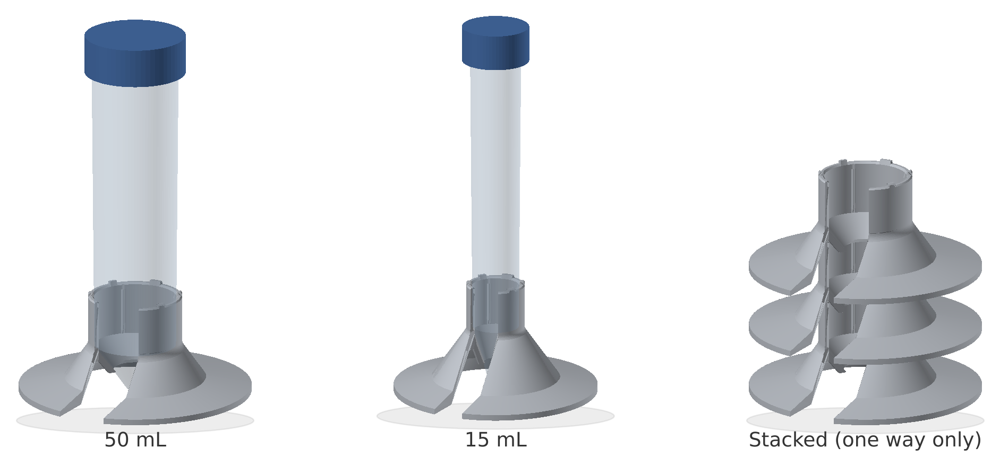

# Stackable Conical Tube Stands

Parametric single-tube stands for conical centrifuge tubes, designed for FDM 3D printing.
Each stand holds one tube upright on a wide, flat base. Empty stands nest into each other
in a fixed orientation for compact storage.

You can generate a stand from just the tube volume (15 or 50 mL, standard Falcon dimensions)
or from your own tube measurements: diameter, cone length and tip angle. One Python script
(`tube_stand.py`, numpy only) derives everything else.

> **Status: untested.** The models have been checked numerically: closed manifold mesh,
> wall thickness, stacking clearance and stacking orientation. They have **not yet been
> printed and tested** with real tubes. Please print one set first to confirm the fit on your
> printer, and feel free to report results via Issues.

 

---

## Why this stand?

- **Supports the tube along its length.** A tall collar holds the tube body, and the seat
  cradles the conical bottom, so the tube stands firmly upright. It does not lean or rock the
  way it can in a shallow holder that grips only the tip.
- **See inside the tube.** The front opening leaves the lower part of the tube visible, so you
  can read the graduations and check how far the liquid (or a pellet) reaches.
- **Convenient for drawing off liquid.** When you aspirate with a peristaltic pump or a pipette,
  you can watch the liquid level and the position of the tubing or tip through the opening while
  the tube stays securely seated.
- **Stores compactly.** Empty stands nest one way only, with all openings aligned.

## Features

- **Self-centring tube seat.** The tube's conical tip rests on a cone-shaped seat, and four
  small ribs inside the collar keep the tube upright.
- **Wide, flat footprint.** A thin flange gives a large contact area (Ø80 mm for 50 mL,
  Ø70 mm for 15 mL), which makes the stands hard to knock over.
- **Front opening.** A C-shaped cut-out lets you see the tube, its graduations and the liquid level.
- **Keyed stacking.** Five tabs on the collar rim fit into matching pockets underneath the
  next stand. One tab is wider than the others, so the stands stack only one way and all
  front openings line up.
- **Minimal supports.** Only the bottom edge of the seat, which hangs inside the stand, needs
  a small support from the build plate. Everything else is self-supporting.
- **Any conical tube.** Give the tube dimensions, and the seat, height, base, front opening and
  stacking features adapt to it.
- **Optional text.** Emboss a lab name inside the skirt or on the flange.

## Repository contents

| Path | Description |
|---|---|
| `tube_stand.py` | Generator script (Python 3.8+, numpy; matplotlib only for optional text) |
| `stl/tube_stand_50mL.stl` | Ready-to-print 50 mL stand (`--volume 50`) |
| `stl/tube_stand_15mL.stl` | Ready-to-print 15 mL stand (`--volume 15`) |
| `images/preview.png` | Rendered preview |
| `LICENSE` | MIT License |
| `CITATION.cff` | Citation metadata (used by GitHub's "Cite this repository") |

| Model | Height | Base | Stack pitch | 5-stack height | Mass (PETG) |
|---|---|---|---|---|---|
| 50 mL | 34 mm | Ø80 mm | 21.8 mm | 122 mm | ~20 g |
| 15 mL | 38 mm | Ø70 mm | 22.3 mm | 128 mm | ~16 g |

The "stack pitch" is how much each extra stand adds to the height of a stack.
The 5-stack heights include the tabs on the top stand.

## Generating a stand

```bash
pip install numpy
```

**By volume.** Standard Falcon dimensions are built in for 15 mL and 50 mL:

```bash
python tube_stand.py --volume 50          # writes tube_stand_50mL.stl
python tube_stand.py --volume 15          # writes tube_stand_15mL.stl
```

**By tube dimensions.** Measure your tube (or take the values from the manufacturer's drawing):

```bash
python tube_stand.py --od-top 30 --od-cone 28.5 --cone-length 20 --tip-angle 60 -o my_tube.stl
python tube_stand.py --od-top 17 --od-cone 16 --cone-length 20 --tip-od 4 -o my_15mL.stl
```

| Option | Tube dimension |
|---|---|
| `--od-top` | Outer diameter near the top of the tube |
| `--od-cone` | Outer diameter where the conical bottom starts |
| `--cone-length` | Length of the conical bottom (from where it starts to the tip) |
| `--tip-angle` **or** `--tip-od` | Full included angle of the cone, **or** the diameter at its tip |

**Mixed.** Start from a volume and replace only what you measured:

```bash
python tube_stand.py --volume 50 --cone-length 18 -o brandX_50mL.stl
```

**Any other parameter** can be changed with `--set` (lengths in mm, angles in degrees):

```bash
python tube_stand.py --volume 15 --set base_d=80 --set seat_margin=2 -o wide15.stl
python tube_stand.py --volume 50 --list   # show every parameter; derived ones are marked (auto)
```

Other options:
- `--profile-csv FILE` also writes the 2D cross-section.
- `--no-check` skips the checks.

### Adding text (optional)

You can emboss a lab name or label. This needs matplotlib for the font outlines
(`pip install matplotlib`). Without `--text`, the script needs only numpy.

```bash
python tube_stand.py --volume 50 --text "Smith Lab"                       # inside the skirt (subtle)
python tube_stand.py --volume 50 --text "Smith Lab" --text-place flange   # on top of the flange
```

- **Placement.**
  - `inner` (default) puts the text on the inside slope of the skirt, opposite the front
    opening. You can see it through the opening, reading left to right.
  - `flange` puts it on the top surface of the flange.
- **Embossed, not engraved.** The letters are raised 0.5 mm, so no wall is made thinner.
  Each letter is a separate closed shell sunk 0.4 mm into the stand. Common slicers
  (PrusaSlicer, Bambu Studio, Cura) merge them automatically.
- **Checks.** The script warns if the text runs into the front opening, does not fit on its
  surface, or would touch the next stand when stacked. It stops if the font is not installed or
  lacks some of the characters, instead of printing empty boxes.
- **Fonts.** The default is DejaVu Sans Bold, which ships with matplotlib and covers Latin
  characters. For Japanese or other scripts, install a font that has them and select it with
  `text_font`.
- **Legibility.** Keep `text_size` at 4 mm or more with a bold font for a 0.4 mm nozzle.

| Parameter | Meaning (default) |
|---|---|
| `text_place` | `inner` or `flange` (`inner`) |
| `text_size` | Font size in mm (4) |
| `text_h` | Emboss height in mm (0.5) |
| `text_z` | `inner`: height of the text centre on the skirt (4 mm) |
| `text_r` | `flange`: radius of the text centre (middle of the flange) |
| `text_angle` | Centre of the text arc in degrees; 90 is opposite the front opening (90) |
| `text_font` | `family:weight` (`DejaVu Sans:bold`) |

### Output and checks

Each run writes the STL file and prints a summary of the checks it ran on the result:

```
tube_stand_50mL.stl: 38930 triangles, volume 15.7 cm3 (~20 g PETG)
  height 33.9 mm, base 80.0 mm, collar ID 28.60 mm (ribs 27.60 mm)
  seat: half-angle 39.0 deg (tube 35.0), lip r=7.54 at z=7.32, tube tip at z=0.50; landing z=12.05
  closed manifold: True
  min wall around landing: 1.75 mm (at pockets 1.50 mm)
  stack pitch 21.84 mm (design 21.85); 5-stack height 122.3 mm
  orientation: unique (tabs fit only in the intended orientation)
```

The checks are:
- **Closed manifold:** the mesh is a single closed surface.
- **Minimum wall thickness:** measured around the landing and the stacking pockets.
- **Stack pitch:** computed from the cross-section.
- **Orientation:** all rotations are tested to make sure the tabs fit only in the intended
  orientation.

The script prints a warning if something looks wrong. If the parameters cannot produce a valid
stand (for example, the cross-section intersects itself or the seat angle is narrower than the
tube tip), it stops and explains why.

### How the design adapts to the tube

When a design value is left at `None` (the default), it is derived from the tube by the rules
below. The rules were fitted to the 15 mL and 50 mL designs and also tested on tubes from about
Ø11 mm to Ø62 mm.

| Value | Rule |
|---|---|
| Collar inner diameter | `od_cone` + 2 × `collar_clear` (0.33 mm) |
| Seat half-angle | tube cone half-angle + `seat_margin` (4°) |
| Seat lip | where the tube radius is 54 % of its radius at the cone start (`lip_frac`), with the tip 0.5 mm above the table (`tip_clear`) |
| Height | top of the seat + 15 mm + 0.11 × `od_top` |
| Base diameter | 55 mm + 0.85 × `od_top`, and at least the skirt footprint + 20 mm |
| Front slot width | 0.5 × `od_top` + 2.3 mm |
| Collar–skirt fillet | 0.17 × `od_top` |
| Tab height | 0.5 + 0.017 × `od_top` (0.8–1.0 mm) |
| Landing height | as high as the clearances allow, lowered (by at most 3 mm) until the wall around the pockets reaches `min_wall` (1.5 mm) |

**About `seat_margin`.** The seat cone is made slightly wider than the tube cone, so the tube
always rests on the seat's lower lip. That way it sits at the same height and stays centred
even with small variations in tube moulding or printing. With `seat_margin=0` the seat matches
the tube angle exactly. The seat root then gets a little thicker, but where the tube makes
contact depends on tolerances. Values of 2–4° are a good compromise.

### Main parameters

| Parameter | Meaning |
|---|---|
| `collar_clear` | Radial clearance between the tube and the collar (increase if tubes are tight) |
| `rib_h`, `rib_angles` | Height of the inward ribs (0 = no ribs) and their angles (`--set rib_angles=-135,-45,45,135`) |
| `seat_margin`, `seat_half_angle` | Seat angle relative to the tube, or set the absolute half-angle |
| `lip_frac`, `lip_z`, `tip_clear` | Seat lip position and the gap between tube tip and table |
| `height`, `base_d` | Overall height and flange diameter |
| `flange_t`, `skirt_angle`, `skirt_t` | Flange rim thickness, skirt slope, and skirt thickness |
| `open_angle`, `slot_width` | Front opening: wedge angle (collar and seat) and slot width (skirt and flange) |
| `n_tabs`, `tab_h`, `tab_w`, `tab_w_key` | Stacking tabs: count (0 = no tabs), height, width, and width of the wider key tab |
| `pocket_clear_r`, `pocket_clear_t`, `pocket_extra_h` | Pocket clearances: radial, tangential, and depth |
| `landing_z`, `min_wall` | Landing height (auto by default) and target minimum wall thickness |

Run `--list` for the full set of parameters.

### How the geometry is built

The stand is a solid of revolution generated from a 2D cross-section (r, z). The front
opening is a wedge through the collar and seat, and a slot of constant width through the
skirt and flange. The ribs, tabs and pockets are added by moving selected points of the
cross-section depending on the angle. This keeps the mesh a single closed surface without
any Boolean operations.

## Built-in tube dimensions

| `--volume` | Reference | Dimensions used |
|---|---|---|
| 50 | Corning Falcon 352070 / 352098 | OD 29.72 / 27.94 mm, cone length 16.0 mm, 70° tip |
| 15 | Corning Falcon 352096 | OD 17.37 / 15.75 mm, cone length 22.48 mm, tip Ø3.18 mm |

Other brands have similar dimensions and may fit the built-in sizes, but this has not been
verified. For a different tube, it is best to measure it and use the dimension options.

### Design details (`--volume 50` / `--volume 15`)

| | 50 mL | 15 mL |
|---|---|---|
| Collar inner diameter | 28.6 mm | 16.4 mm |
| Rib inner diameter (4 ribs) | 27.6 mm | 15.4 mm |
| Seat (included angle) | 78° (tube tip 70°) | 39° (tube tip ~31°) |
| Tube tip clearance above table | 0.5 mm | 0.5 mm |
| Front opening | 68.5° (collar/seat), 17.2 mm slot (skirt) | 68.5° (collar/seat), 11.0 mm slot (skirt) |
| Flange thickness at rim | 1.8 mm | 1.8 mm |
| Minimum wall thickness | 1.5 mm (at stacking pockets) | 1.6 mm (at stacking pockets) |

## Printing

| Setting | Recommendation |
|---|---|
| Material | **PETG** recommended; PLA is fine for a quick fit test |
| Nozzle / layer height | 0.4 mm / 0.2 mm |
| Walls | 3 perimeters (most sections are then effectively solid) |
| Infill | 20–40 % (only a few regions have room for infill) |
| Supports | **Required under the seat only.** The seat's lowest edge (z ≈ 7 mm for 50 mL, 10 mm for 15 mL) starts in mid-air inside the stand. Use supports "on build plate only"; tree/organic supports work well and are easy to remove through the open bottom |
| Orientation | As generated, flange down |
| Bridging | Enable bridge settings (more cooling, slower speed) for the flat landing under the seat and the stacking pockets |
| Adhesion | A brim is optional; consider one if the thin flange edge lifts |

**Why PETG?** The collar flexes slightly when you insert a tube. PETG is tougher than PLA
and less likely to crack after repeated use, especially when cold, and it prints without an
enclosure. ABS/ASA and PP warp too easily for the thin, wide flange.

## Use and care

- **Temperature.** Intended for room temperature and 4 °C.
- **−80 °C.** Use is possible, with care:
  - Insert and remove tubes at room temperature (or at least at 4 °C). Do not snap tubes in or
    out while the stand is frozen, because plastics become brittle when cold.
  - Do not store stands stacked in the freezer. Frost in the 0.3 mm clearances can freeze them
    together.
  - When cold, the tube shrinks slightly more than the stand, so the ribs grip more loosely.
    The tube still rests securely on the seat.
- **Cleaning.** Wipe with 70 % ethanol.
- **Not autoclavable.** Common FDM materials do not survive 121 °C.
- **Stacking.** Stack empty stands only. Five or six per stack is a good everyday limit
  (5-stack: about 120–130 mm). Taller stacks tip over more easily, regardless of orientation.

## Author

Yu Iritani — Department of Chemistry, Graduate School of Science, The University of Osaka

## Acknowledgements

The overall layout was inspired by
[UPDATE 08.26 stackable 50mL Falcon tube stand – Project OpenBenchTop](https://www.printables.com/model/1256006-update-0826-stackable-50ml-falcon-tube-stand-proje)
by jojo ([@jojojo](https://www.printables.com/@jojojo)) on Printables. That design combines a
tall collar, an inner seat cone and a flared skirt. No files or mesh data from that model are
included in or used by this repository: all geometry here is generated from scratch by
`tube_stand.py`.

## License

Released under the [MIT License](LICENSE). This covers the script, the STL files and the
images. You may use, modify and share them, including in your own designs, provided the
copyright notice is kept.

"Falcon" is a trademark of Corning Incorporated. This project is not affiliated with or
endorsed by Corning. "Falcon" is used here only to identify the tubes the default dimensions
were taken from.

## Citation

If these stands are useful in your work, please cite this repository. GitHub's
**"Cite this repository"** button (right sidebar) gives the reference in APA and BibTeX format.

> Iritani, Y. (2026). *Stackable Conical Tube Stands* (version 1.0).
> https://github.com/yakamasiinen/conical-tube-stand
